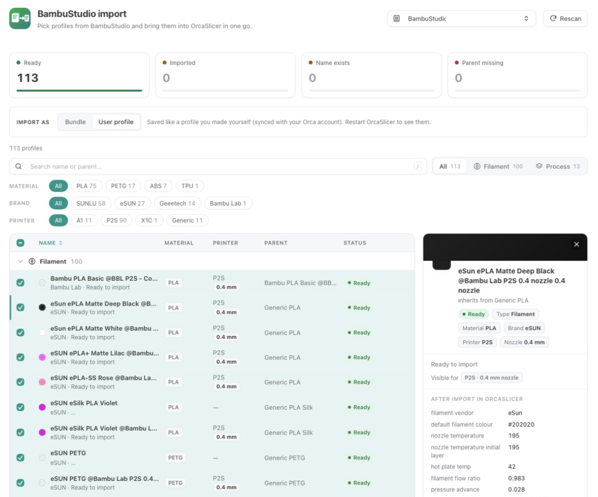

# BambuStudio Import for OrcaSlicer

*English · [Nederlands](README.nl.md)*

A plugin for OrcaSlicer 2.5 (nightly builds with Python plugins) that brings your
own BambuStudio profiles — filament, process and printer — into OrcaSlicer.
Tick the profiles you want and import them in one go.



## Features

- Reads your BambuStudio user profiles (and `BambuStudioBeta` if present).
  BambuStudio itself is never modified. It looks in:
  - macOS: `~/Library/Application Support/BambuStudio/user/<account>/`
  - Windows: `%APPDATA%\BambuStudio\user\<account>\`
  - Linux: `~/.config/BambuStudio/user/<account>/`, or for the Flatpak
    `~/.var/app/com.bambulab.BambuStudio/config/BambuStudio/user/<account>/`
- Shows per profile whether it can work in OrcaSlicer: **Ready**, **Updated**
  (changed in BambuStudio since the import), **Imported**, **Name exists**,
  **Parent missing** or **Invalid**.
- Filter by type, material, brand and printer; search; a details panel shows the
  settings exactly as they will land in OrcaSlicer.
- Shows which printer and nozzle a profile is for (e.g. *P2S · 0.2 mm nozzle*)
  and warns when OrcaSlicer hides it for the printer you have selected.
- Choose how to import (**Import as**):
  - **Bundle** — into a local preset bundle
    `OrcaSlicer/user/<account>/_local/bambustudio_import/`, loaded right away
    without a restart and easy to remove in one go.
  - **User profile** — as a regular user preset in
    `OrcaSlicer/user/<account>/<filament|process|machine>/`, just like a profile
    you saved yourself (synced with your Orca account). Visible after restarting
    OrcaSlicer.

  A profile that was imported before is updated where it already lives, so it
  never ends up twice in OrcaSlicer.
- **Remove** imported profiles again: per selection, from the details panel, or
  all at once. User profiles are removed from your Orca account too at the next
  start. Presets you did not import with this plugin are never touched.
- Settings OrcaSlicer does not know are left out; the import report lists them
  per profile. BambuStudio user profiles that inherit from other user profiles
  are flattened, since OrcaSlicer only lets presets inherit from system presets.
- English and Dutch UI, following OrcaSlicer's language.

## Install

From [OrcaCloud](https://cloud.orcaslicer.com/app/plugins/shared-plugins), or
from this repository:

```sh
python3 scripts/install.py
```

On Windows: `py scripts\install.py`. For a portable OrcaSlicer or another data
folder, pass that folder: `python3 scripts/install.py <folder>`. Or copy
`orca_plugins/bambustudio_import/bambustudio_import.py` by hand to
`<OrcaSlicer data folder>/orca_plugins/bambustudio_import/`.

Restart OrcaSlicer, enable the plugin in **File → Plugins** and allow it to read
the BambuStudio folder. The **BambuStudio import** tab then appears in the top
bar.

Tested on macOS. Windows and Linux are supported in the code and the tests but
not yet tried in a real OrcaSlicer — please
[open an issue](../../issues) if something doesn't work. If OrcaSlicer itself
runs as a Flatpak, that Flatpak needs read access to the BambuStudio folder
(e.g. with Flatseal or
`flatpak override --user --filesystem=~/.config/BambuStudio:ro com.orcaslicer.OrcaSlicer`).

## Uninstall

1. In the tab, remove the imported profiles (select them and choose
   **Remove (n)**, or use **Remove all imported**).
2. Delete the folder `OrcaSlicer/orca_plugins/bambustudio_import/`.

## Development

```sh
python3 -m pytest
```

The tests run without OrcaSlicer; the `orca` module is optional. JavaScript
checks in the tests use `node` when it is installed.

## Releasing

Publishing to OrcaCloud is automated with
[`.github/workflows/publish-orcacloud.yml`](.github/workflows/publish-orcacloud.yml):

1. Bump `# version = "x.y.z"` in the plugin header and push.
2. Create a GitHub release with tag `vx.y.z` (same version) and publish it.
   The release notes become the OrcaCloud changelog.

The workflow runs the tests, checks that the tag matches the plugin version and
uploads `bambustudio_import_any.py`. OrcaCloud runs its automated review; the
release then shows up on the plugin page.

## License

[MIT](LICENSE)
